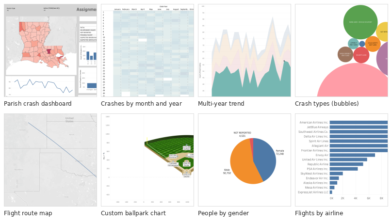

# Tableau Visual Analytics

Tableau workbooks from ISDS 7304 (Data Visualization) in the LSU M.S. in Analytics: Louisiana traffic-crash analysis, maps and flight routes, airline performance, and a custom ballpark chart built from a background image.

## Workbooks

| Workbook | Data | Techniques |
|---|---|---|
| `01_louisiana_fatal_crashes.twbx` | Louisiana fatal crashes | Bar charts, sorting, highlighting, a state map, crosstabs |
| `02_multi_year_crash_trends.twbx` | Multi-year fatal crash data | Area and line trends, month × year heatmap, time binning, parts-of-whole |
| `03_crash_table_calculations.twbx` | Multi-year fatal crash data | Running totals, percent of total, quarterly tables |
| `04_maps_flight_routes_and_ballpark.twbx` | Flights/airports and baseball fielding data | Symbol and filled maps, flight-path lines, radius map, scatter plot on a ballpark background image |
| `05_louisiana_crash_dashboard.twbx` | Crash and person data joined to parish population | Filled parish map, per-capita rates, bubble chart, dashboard with filter actions and reset |
| `06_airline_performance.twbx` | Flights with multiple joined sources and state population | Carrier comparisons, weekday breakdowns, state-level rates, multi-source joins |

Each `.twbx` packages its own data extract, so it opens without extra files.

## Open them

- Download [Tableau Public](https://www.tableau.com/products/public/download) (free) or use Tableau Desktop.
- Open any file in `workbooks/`. Each worksheet tab is one question from the assignment.

## Data sources

Louisiana crash records and population figures, U.S. flight and airport data, and baseball fielding statistics, as provided for the course.
